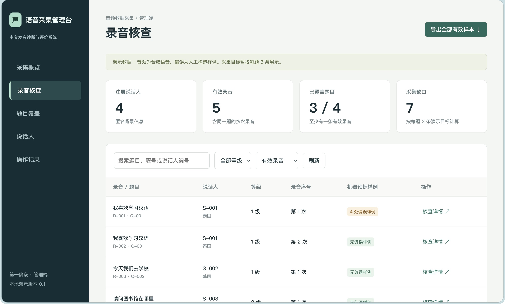

# 中文发音诊断与评价系统 管理端

本仓库用于闫晓奕、周佳怡、王阳协作开发第一阶段的管理端子系统，保存需求、接口约定、原型代码、汇报材料和验证证据。

截至 **2026年11月16日第一周**，已完成需求拆解、技术路线初选、三人分工、接口草案和可运行的本地原型。原型使用原生 HTML/CSS/JavaScript、Python 标准库和 SQLite。Vue 3、FastAPI 是正式开发候选，尚未确定为统一技术栈。

## 新成员先看这里

1. 阅读[第一周进展](reports/week-01/README.md)，区分已完成和待完成范围。
2. 查看[分工与验收清单](docs/team/分工与验收清单.txt)和[组员接手指南](docs/team/接手指南.md)，找到自己的模块。
3. 按下方命令启动原型，体验筛选、回听、备注、删除恢复和导出。
4. 阅读[管理端需求](docs/requirements/管理端需求与实施方案.txt)、[接口草案](docs/api/三端接口与数据契约草案.txt)及[JSON样例](docs/api/接口样例_讨论稿.json)。
5. 开始修改前查看[协作约定](CONTRIBUTING.md)，先约定接口和公共文件的修改范围。

## 三人分工

| 成员 | 开发主责 | 首先阅读的代码 | 主要难点 |
|---|---|---|---|
| 周佳怡 | 管理界面、用户与题目表单、录音核查、偏误展示 | `prototype/static/` | 偏误位置、页面状态与接口交互 |
| 闫晓奕 | 核心数据管理、可撤销操作、权限、三端对接 | `prototype/server.py` | 数据关联、事务、版本冲突与联调 |
| 王阳 | 统计接口及页面、数据导出、脚本校验、部署说明 | `server.py` 的导出、`app.js` 的统计、`verify.py` | 统计口径与音频、清单、标注的一致性 |

每个人验证自己的模块。闫晓奕牵头跨端联调，周佳怡检查页面操作和演示流程，王阳整理部署步骤，三人共同完成部署与验收。

## 目录

```text
prototype/                  可运行的管理端原型与15项检查
docs/requirements/          第一阶段需求梳理、管理端实施方案
docs/api/                   三端接口草案与JSON字段样例
docs/team/                  已确认分工、接手指南、待协调事项
docs/references/             老师任务书与参考资料来源说明
reports/week-01/             第一周进展、11页PPT、逐页讲稿与演示步骤
evidence/                   原型截图、验证记录、演示导出包
packages/                   第一周完整离线成果包与校验文件
scripts/                    生成离线成果包的脚本
CONTRIBUTING.md              分支、提交、联调和验收约定
```

## 运行原型

需要 Python 3.9 或以上，不需要安装第三方 Python 包。音频文件已包含在仓库中。

先克隆仓库：

```bash
git clone https://github.com/Parallaxxion/-cowork.git pronunciation-admin
cd pronunciation-admin
```

macOS / Linux：

```bash
python3 prototype/server.py --open-browser
```

Windows PowerShell：

```powershell
py -3 prototype/server.py --open-browser
```

也可以在 macOS 双击 `prototype/启动演示.command`。若执行权限丢失，可在终端使用上面的 Python 命令。

浏览器访问 **http://127.0.0.1:8765**。保持终端开启，按 Ctrl+C 结束服务。该地址只在运行程序的本机有效，线上汇报共享浏览器窗口。

第一次运行自动生成 `prototype/demo.sqlite3`。备注、删除等修改会持久保留，数据库不提交到仓库。需要另一套独立演示数据时，指定新的数据库路径：

```bash
ADMIN_DEMO_DB=/tmp/admin-demo-session.sqlite3 python3 prototype/server.py
```

Windows PowerShell 可先执行 `$env:ADMIN_DEMO_DB = "$env:TEMP/admin-demo-session.sqlite3"`，再运行启动命令。端口占用时可通过环境变量 `ADMIN_DEMO_PORT` 指定其他端口。

## 验证与演示

在仓库根目录执行：

```bash
python3 prototype/verify.py
```

Windows 使用 `py -3 prototype/verify.py`。检查使用独立临时数据库和临时端口，不改动自己的演示数据库；成功后会更新 `evidence/验证记录.txt` 和 `evidence/演示导出包.zip`。浏览器交互和实际播放需另行检查，脚本不能替代这些操作。

已有检查覆盖初始关联、统计、四类偏误样例、备注保存、过期更新冲突、删除恢复、撤销和导出关联。完整操作见[汇报讲稿与演示步骤](reports/week-01/汇报讲稿与演示步骤.txt)。



## 当前功能和边界

| 功能 | 第一周完成情况 |
|---|---|
| 查询和统计 | 可按说话人、题目、录音号、等级筛选，显示收录量与演示缺口 |
| 录音核查 | 回听、编号溯源、四类偏误样例展示、核查备注 |
| 数据操作 | 录音备注修改、软删除、恢复、带版本保护的单次撤销 |
| 数据导出 | 未删除样本的音频、元数据、匿名背景和偏误标注 ZIP |
| 完整用户/题目/录音管理 | 待补齐新增、修改、删除与完整撤销规则 |
| 三端集成和部署 | 真实接口、认证、HTTPS、负载验证与试点待完成 |

原型中的人员背景是虚构信息，声音为合成语音，偏误为人工构造样例。正常合成语音不一定包含画面上标注的错误。本仓库管理端负责展示和导出诊断结果，任务书中的基线算法由学生端承担。

每题目标3条、初始4人4题5条录音和缺口7条是演示设定。“有效录音”当前只表示未删除，不代表音质已验收合格。正式采集目标、重录计数口径及最终截止日待老师或师兄确认，11月29日只是建议计划节点。

## 获取第一周成果

- [汇报PPT](reports/week-01/管理端第一阶段进展汇报_20261116.pptx)：11页，包含三人分工及逐页演讲备注。
- [汇报讲稿](reports/week-01/汇报讲稿与演示步骤.txt)：约7—8分钟正文和2分钟演示。
- [完整离线包与下载说明](packages/README.md)：按同一目录分类，解压后可运行原型。
- [待协调问题](docs/team/待协调事项.md)：技术资源、两端样例与权限、采集目标和验收节点。

后续开发以仓库中的源码与最新接口约定为准，第一周压缩包作为2026年11月16日的阶段快照保留。
